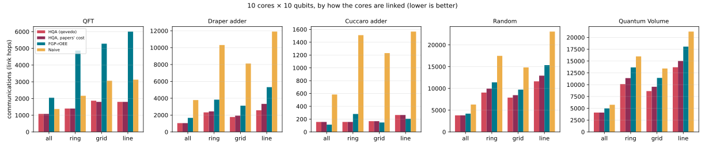
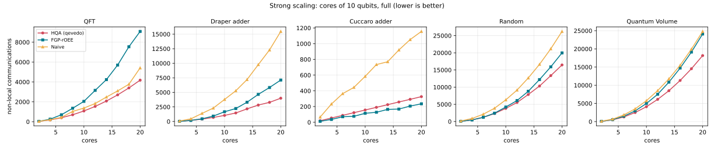
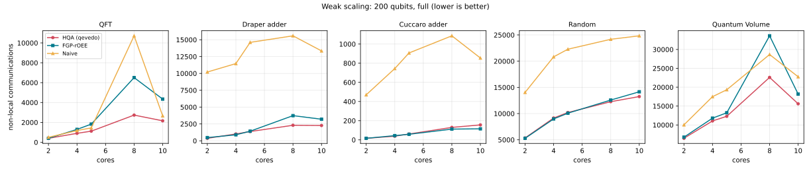
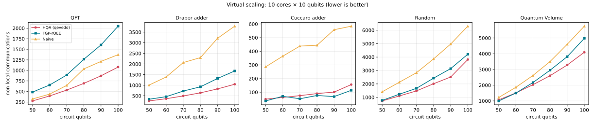

# Mapping onto multi-core quantum computers

Quantum processors are hard to grow as single chips, so one route to scale is
a **modular** or **multi-core** machine: several small processors (cores)
connected by quantum links. A two-qubit gate can only run when both qubits are
in the same core, and moving a qubit to another core (by teleportation, using
an EPR pair) is slow and noisy. Before every step of the circuit, a *mapper*
decides which core each qubit is in, with as few moves, or **non-local
communications**, as possible.

`qevedo-compiler` implements the Hungarian Qubit Assignment (HQA) mapper of
Escofet et al. and the mappers it was compared with, in the Rust core, with a
Python API.

## Quick start

```python
from qevedo.compiler.multicore import map_and_route, map_to_cores

mapping = map_to_cores(open("circuit.qasm").read(), cores=4, qubits_per_core=10)
print(mapping.communications)    # teleportations needed
print(mapping.assignments[0])    # core of each qubit during the first timeslice
print(mapping.moves()[3])        # (qubit, from core, to core) before timeslice 3

# Cores in a line, a ring, a grid, or linked by any connected set of links:
mapping = map_to_cores(circuit, cores=8, qubits_per_core=10, topology="grid:2x4")
mapping = map_to_cores(circuit, cores=4, qubits_per_core=10, topology=[(0, 1), (1, 2), (1, 3)])

# Qubits inside each core coupled in a 3 × 3 grid: route each core with SABRE
# and get a circuit on physical qubits, with SWAPs and teleportations.
result = map_and_route(circuit, cores=4, qubits_per_core=9, chip="grid:3x3")
print(result.teleportations, result.swaps)
print(result.circuit.instructions[:5])   # cx, swap and teleport on q[0..35]
```

`map_to_cores` also takes a parsed `Circuit` or a list of two-qubit gates as
qubit pairs, and a `method`:

| method | what it does |
|---|---|
| `"hqa"` (default) | Hungarian Qubit Assignment with look-ahead attraction |
| `"hqa-no-lookahead"` | HQA without the attraction term |
| `"hqa-uniform-cost"` | HQA counting every move as one teleportation (the papers' cost), even across unlinked cores |
| `"fgp-roee"` | Fine-Grained Partitioning with relaxed Overall Extreme Exchange |
| `"naive"` | move one qubit of each split gate to the other's core |

From Rust, `qcc::multicore::{Architecture, Timeslices, map, Method}` (and
`map_and_route` with a `qcc::routing::CouplingGraph` for the chip), with
`Architecture::new` (all to all), `line`, `ring`, `grid` or `with_links` (see
`core/examples/multicore.rs`, run with
`cargo run --release --example multicore -- 100 10`).

## The model

As in the papers:

- `cores` cores of `qubits_per_core` physical qubits each;
- each core is all-to-all inside, and the cores are all-to-all between each
  other, so moving a qubit's state to any other core is one communication
  (beyond the papers, the cores can instead be linked in a line, a ring, a
  grid or any connected way; then a move takes one communication per link on
  the shortest path);
- the circuit is cut into **timeslices**, sets of two-qubit gates that run in
  parallel (each qubit in at most one gate per slice), built as soon as
  possible; single-qubit gates do not constrain the mapping;
- the cost is the number of times a qubit is in a different core than in the
  step before (times the links crossed, on sparse links). The initial
  placement is free.

## How HQA works

Before each timeslice, the gates whose qubits are in different cores
("unfeasible" gates) are collected and their qubits taken out of their cores.
Gates, not qubits, are then assigned to cores: the Hungarian algorithm solves
a gates × cores cost matrix, giving each core at most one gate per round, and
both qubits of a gate go into the free space of its core. Rounds repeat until
every gate is placed. The cost of putting gate (qA, qB) in core c is

```
∞                if c has fewer than two free slots
1 − attr(op, c)  if qA or qB was in c before the slice (one teleportation)
2 − attr(op, c)  otherwise (two teleportations)
```

where `attr(op, c)` is the mean attraction of qA and qB to c: the sum, over
their future interactions, of `2^−(m−t)` for interactions `m − t` slices
ahead with a qubit now in c. Every mapper starts from the same placement: an
OEE partition of how often each pair of qubits interacts.

On sparse links, the papers note the cost "can be adapted"; here both terms
count teleportations: the links qA and qB cross to reach c, plus, for the
look-ahead, the links each would cross from c to meet its future partners,
weighted by `2^−(m−t)`. With every core linked to every other this differs
from the formula above by a constant per gate, so the Hungarian algorithm
makes the same choices.

## Routing inside the cores

The mappers, like the papers, take every core as all-to-all inside. When the
qubits of a core are coupled in a line, a grid or any other graph (the
*chip*), `map_and_route` also produces the circuit that runs:

1. The timeslices are grouped into **epochs**, runs in which no qubit changes
   core.
2. In each epoch, each core runs its part of the circuit, single-qubit gates
   and measurements included, routed on its chip with **SABRE** (Li, Ding and
   Xie, ASPLOS 2019), which inserts SWAPs. Each core starts where the
   previous epoch left its qubits; the first epoch's layout comes from
   SABRE's forward–backward layout search.
3. Between epochs, the qubits that change core are **teleported**. A qubit
   arriving in a core takes the free slot closest to the qubit it interacts
   with next, or, if that one has not arrived yet, the free slot with most
   free neighbours, so the partner can land next to it.

The output is a circuit on `cores × qubits_per_core` physical qubits, where
`q[c · qubits_per_core + s]` is slot `s` of core `c`, with `swap` inside
cores and `teleport source, destination` between them. The teleportations
before a timeslice happen at once (as with communication qubits in each
core): a destination is empty or is being left by another teleportation.
They are listed so that each destination is already free whenever possible.
Tests simulate the routed circuits and check that they compute the same state
as the original.

The SABRE router is a module of its own (`core/src/routing/`) and routes any
circuit on any connected chip; on 20-qubit lines, 5 × 5 grids and 19-qubit
heavy-hex chips it inserts about as many SWAPs as Qiskit's `SabreLayout`
(2774 against 2806 over QFT, random, Quantum Volume and Cuccaro circuits).

## Code

Rust, in `core/src/multicore/`, one concept per file:

| file | what it holds |
|---|---|
| `mod.rs` | overview, `Method`, `initial_placement`, `map` |
| `architecture.rs` | the hardware model: cores and the links between them |
| `timeslices.rs` | circuits as timeslices of two-qubit gates |
| `assignment.rs` | assignments, mappings, validity, communication count |
| `lookahead.rs` | how future interactions attract qubits to cores |
| `hungarian.rs` | the Hungarian algorithm (minimum-cost assignment) |
| `oee.rs` | Overall Extreme Exchange graph partitioning |
| `hqa.rs` | Hungarian Qubit Assignment |
| `baselines.rs` | the naive and FGP-rOEE mappers |
| `physical.rs` | routing inside cores and teleportations: a circuit that runs |
| `bounds.rs` | theoretical bounds for random circuits |

and in `core/src/routing/`, `coupling.rs` (chips: coupling graphs and their
distances) and `sabre.rs` (the SABRE router and layout search).

Python: `python/qevedo/compiler/multicore.py` (API) and the
`map_to_cores` and `map_and_route` bindings in `python/src/lib.rs`. Tests: the `tests` module of
each Rust file (including a randomized test of every method on 300 random
architectures and circuits) and `python/tests/test_multicore.py`.

## Choices beyond the papers

The papers leave some details open, and use cores of even size. Where the
code had to decide, it says so in `hqa.rs` and `baselines.rs`:

- **Ties** in the Hungarian algorithm go to the lower-numbered gate and core.
- **Look-ahead** stops after 64 slices, past which `2^−64` terms are below
  rounding.
- **Free space** must come in pairs. As in the papers, two cores with an odd
  number of free slots get an auxiliary gate between an idle qubit of each
  (the one least attracted to its core), only when the free space would
  otherwise not hold the gates.
- **Odd core sizes**: a timeslice can then hold more gates than the cores can
  run at once, so `Timeslices::fitted_to` splits it. If the auxiliary-gate rule
  cannot apply (no idle qubit in the odd cores), an idle qubit moves between
  them, or, as a last resort, every idle qubit is taken out and put back after
  the gates; the naive mapper and FGP-rOEE likewise fall back to moving the
  other qubit, or both, when the first move is impossible.

- **Sparse links** (not in the papers): the cost counts link hops now and in
  the look-ahead, as above. A small cost per moved qubit (0.01) breaks ties
  between moving one qubit and moving both to a core in between, which cost
  as many hops but disturb two placements; it was chosen on these benchmarks,
  but any value from 0.001 to 0.05 gives totals within 1%. The initial OEE
  groups go to cores so that groups that interact most are close.

## Reproducing the papers' comparison

`benchmarks/multicore/` runs the experiments of the 2025 paper on its
benchmarks (QFT, Draper and Cuccaro adders, random circuits of depth twice the
qubits, Quantum Volume; built with Qiskit and transpiled to CX):

```bash
pip install qiskit matplotlib
python benchmarks/multicore/run.py      # about a minute; --quick for a few points
python benchmarks/multicore/plot.py     # charts and the summary table
```

Results (`benchmarks/multicore/results/multicore.csv`, Intel i9-14900K):

| benchmark | FGP-rOEE / HQA communications | naive / HQA | FGP-rOEE / HQA time |
|---|---|---|---|
| QFT | 1.84× | 1.23× | 20.9× |
| Draper adder | 1.44× | 3.74× | 10.8× |
| Cuccaro adder | 0.73× | 4.30× | 4.9× |
| Random | 1.10× | 1.87× | 6.5× |
| Quantum Volume | 1.16× | 1.39× | 9.2× |
| **all points** | **1.24× (mean)** | **3.45× (mean)** | **7.8× (median)** |

Medians per benchmark over the virtual, weak and strong scaling
configurations; above 1 means HQA needs fewer communications or less time.

- HQA needs **1.24× fewer communications** than FGP-rOEE on average, in line
  with the 1.28× of the original HQA paper (the extended paper reports 1.56×
  over a different set of configurations), and is a median **8× faster**.
- The look-ahead attraction matters as the paper says: on Cuccaro adders with
  16 qubits per core, HQA without it needs 1.7–3.9× more communications
  (the paper: 2.27× on average).
- On the Cuccaro adder, whose gates mostly join neighbouring qubits,
  FGP-rOEE needs fewer communications than HQA here (0.73×).
- On random circuits HQA goes below the papers' "lower bound", which assumes
  qubits only move when a gate needs them; HQA moves them ahead of time.

### Sparse links

An experiment the papers do not have: 100-qubit circuits on 10 cores of 10
qubits, linked all to all, in a ring, in a 2 × 5 grid or in a line.
Communications count link hops. Mean ratios over the five benchmarks:

| links | papers' cost / HQA | FGP-rOEE / HQA | naive / HQA |
|---|---|---|---|
| all to all | 1.00× | 1.31× | 2.34× |
| ring | 1.06× | 1.91× | 3.84× |
| 2 × 5 grid | 1.04× | 1.60× | 3.39× |
| line | 1.10× | 1.76× | 3.17× |

- Counting link hops in HQA's cost saves 4–10% over the papers' cost, most on
  the line, where distances are largest.
- HQA's lead over FGP-rOEE grows on sparse links: 1.6–1.9× fewer
  communications, against 1.3× with all cores linked to all.

### Routing inside the cores

The same 100-qubit circuits on 10 cores of 10 qubits (cores linked all to
all), now with the qubits of each core coupled in a 2 × 5 grid or a line
(`results/routing.csv`). Totals over the five benchmarks:

| chip | method | teleportations | SWAPs |
|---|---|---|---|
| 2 × 5 grid | HQA | **10193** | 16105 |
| | FGP-rOEE | 13023 | 15020 |
| | naive | 17790 | 11464 |
| line | HQA | **10193** | 29459 |
| | FGP-rOEE | 13023 | 29138 |
| | naive | 17790 | 22938 |

- Fewer teleportations can cost SWAPs: the naive mapper moves a qubit only
  to meet its partner, so it lands next to it, while HQA also moves qubits
  ahead of time, before their partners are there.
- Still, HQA has the lowest total wherever one teleportation costs more than
  2.1 SWAPs (the largest break-even over every benchmark and both chips),
  and a teleportation, which consumes an EPR pair shared across a link and
  needs a Bell measurement, costs far more than a local SWAP on any hardware
  proposed. The exception is again the Cuccaro adder, where FGP-rOEE needs
  fewer teleportations (114 against 156) and HQA fewer SWAPs.
- Choosing the slot of an arriving qubit by its next partner, rather than
  the first free slot, saves 18% of the SWAPs over all these runs.






## References

- P. Escofet, A. Ovide, C. G. Almudéver, E. Alarcón and S. Abadal, "Hungarian
  Qubit Assignment for Optimized Mapping of Quantum Circuits on Multi-Core
  Architectures", [arXiv:2309.12182](https://arxiv.org/abs/2309.12182) (2023).
- P. Escofet et al. (with M. Bandic, L. Prielinger, H. van Someren, S. Feld
  and C. G. Almudéver), "Revisiting the Mapping of Quantum Circuits: Entering
  the Multi-Core Era", ACM Transactions on Quantum Computing 6(1) (2025),
  [arXiv:2403.17205](https://arxiv.org/abs/2403.17205).
- J. M. Baker et al., "Time-sliced quantum circuit partitioning for modular
  architectures", Computing Frontiers (2020): FGP-rOEE.
- G. Li, Y. Ding and Y. Xie, "Tackling the Qubit Mapping Problem for
  NISQ-Era Quantum Devices", ASPLOS (2019),
  [arXiv:1809.02573](https://arxiv.org/abs/1809.02573): SABRE.
- A. Ovide et al., "Mapping quantum algorithms to multi-core quantum computing
  architectures", [arXiv:2303.16125](https://arxiv.org/abs/2303.16125) (2023).
